# AWS Enterprise Integration Patterns — CDK Construct Library

Declarative AWS CDK constructs implementing the canonical [Enterprise Integration Patterns](https://www.enterpriseintegrationpatterns.com/) (Hohpe & Woolf). Deploy production-ready messaging architectures with a single construct declaration.

The library packages 29 canonical integration patterns as reusable L3 constructs — pub/sub, request-reply,
content-based routing, scatter-gather, splitter, aggregator, resequencer, saga (choreographed and
orchestrated), claim check, outbox, idempotent receiver, circuit breaker, throttling, managed file
transfer and more. Each construct wires the underlying AWS services (EventBridge, SNS, SQS, Step
Functions, Lambda, Kinesis, DynamoDB, AppSync, Amazon MQ, Transfer Family) with dead-letter queues,
retries, encryption and least-privilege IAM already in place, so you declare the pattern rather than
assemble the plumbing.

It is aimed at teams replacing legacy middleware — BizTalk, MuleSoft, Boomi, TIBCO, Informatica,
Workato — or standardising a sprawl of hand-rolled integrations onto one reviewed set of building
blocks. Patterns compose: a file-based interface is usually `FileTransfer` plus `MessageTranslator`
plus `Splitter`, not one bespoke stack.

Alongside the constructs, the repo ships an agent-led discovery pathway: two Agent Skills and two
custom agents that let a coding assistant run the engagement with you. `integration-advisor` asks the
discovery questions, maps each of your existing interfaces to a construct, and writes an assessment
file; `eip-architect` picks that assessment up and writes the CDK against the real props interfaces.
See [Use with an AI coding agent](#use-with-an-ai-coding-agent) — it works from a plain clone, with no
install or configuration step.

## Prerequisites

- An AWS account with the AWS CDK bootstrapped in your target Region
- Node.js 20+
- AWS CDK CLI v2
- AWS credentials configured
- TypeScript 5.x
- For Path 2 below, [Kiro](https://kiro.dev) or Claude Code

Running the test suite on a memory-constrained machine? Each Jest worker loads its own copy of
`aws-cdk-lib`, so use `npm test -- --runInBand` for a fully serial run.

## Getting Started

There are two ways to go from a requirement to a deployed pattern.

**Path 1 is hands-on:** you write the construct declaration and run the CDK commands yourself.
**Path 2 is agent-assisted:** the agents shipped in this repository select and configure the
construct for you, and you run the final deploy.

Both produce the same thing — a small `bin/app.ts` that instantiates one or more of the 29 library
constructs — so the security posture is identical whichever you choose. Start with Path 1 if you
already know which pattern you need. Start with Path 2 if you are coming from a legacy platform's
vocabulary and want help mapping it.

Both paths begin the same way:

```bash
git clone https://github.com/aws-samples/sample-enterprise-integration-patterns-cdk.git
cd sample-enterprise-integration-patterns-cdk
npm ci
npm run build
npm test
```

This repository is a construct library, not a deployable application. `bin/app.ts` ships as an
empty stub, and `npx cdk synth` on a fresh clone produces no stacks by design.

### Path 1: declare a pattern yourself

Open `bin/app.ts` and declare the construct you need. The [Implementation Guide](#implementation-guide)
has worked examples for request-reply, publish-subscribe, scatter-gather and saga. Then synthesize
and deploy:

```bash
npx cdk synth
npx cdk deploy
```

`npm run build` type-checks your declaration against the construct's real `*Props` interface, and
`cdk synth` confirms it produces valid CloudFormation, so a wrong prop name fails before anything
reaches your account. `npm test` exercises the 29 library constructs themselves rather than your
declaration; it confirms the library is intact.

### Path 2: let the agents do the selection and configuration

Open the repository in Kiro or Claude Code. In Kiro, pick the agent from the bottom bar of the chat
input; in Claude Code, ask it to delegate, for example *"use the eip-architect agent to design the
order export interface."*

Describe the integration requirement in your own terms. The agent selects the right construct from
the library, writes the declaration into `bin/app.ts` with correctly configured props, and validates
it with `npm run build`, `npm test` and `cdk synth`. Deployment stays with you: the shipped
`eip-architect` agent is denied `cdk deploy` and `cdk destroy` by design, so nothing reaches an
account without a human running it. When the agent reports the declaration ready, you run the same
two commands as Path 1.

The repo ships two Agent Skills and two custom agents for this. Use them in order, or go straight to
the second if you already know what you are building:

- **`integration-advisor`** runs discovery. It asks the questions, maps each of your existing
  interfaces to a construct, and writes an assessment file. It touches no code.
- **`eip-architect`** picks that assessment up and writes the CDK declarations that instantiate the
  right library constructs with the correct configuration for each pattern, then verifies them.

**Want to see it run before trying it on your own estate?**
[`examples/path-2-with-agents/`](examples/path-2-with-agents/README.md) is a scripted, 25-minute
walkthrough: five BizTalk interfaces at a fictional retailer, ten prompts you type, and what each
agent does in response. It covers the handoff between the two agents, a contrast pair (two BizTalk
orchestrations that map to different constructs on one answer), a three-construct composition, and
the moment the architect refuses to deploy. Swap in your own interfaces at Prompt 3 to use it as a
template for a real engagement.

The [Use with an AI coding agent](#use-with-an-ai-coding-agent) section below covers the agents in
depth: which to start with, what each produces, and how to run them in each tool.

### Clean up

Remove anything you deployed with `npx cdk destroy`. The constructs default to
`RemovalPolicy.DESTROY`, so the queues, tables and buckets a pattern created are removed with the
stack.

### Using the constructs in your own CDK app

`bin/app.ts` is a convenient place to try a pattern. For your own platform you will not build inside
a clone of this repository; bring the constructs into your own CDK application instead. This is
sample code and is not published to the npm registry, so take one of two routes:

- **Vendor the source.** Copy `lib/` into your project and import from it directly. You own the
  code from that point and can adapt it freely; this is the intended way to consume a sample.
- **Install from the Git URL.** `npm install github:aws-samples/sample-enterprise-integration-patterns-cdk`
  pulls the repository as a dependency. Run `npm run build` inside it once so `dist/` exists, then
  import from the package root.

Either way, `aws-cdk-lib` and `constructs` are peer dependencies, so your app supplies them. The
agents work the same way in your repository as in this one.

## Use with an AI coding agent

This repo ships two [Agent Skills](https://agentskills.io) and two custom agents that teach a coding
assistant how to assess an integration estate and how to pick and configure these constructs. Clone
the repo and they work — no install step, no configuration.

| What | Name | Purpose |
|---|---|---|
| Skill | `integration-discovery` | Welcome, discovery questions, legacy platform mapping, assessment template |
| Skill | `eip-cdk-patterns` | Selection workflow, construct catalog, anti-pattern guardrails |
| Agent | `integration-advisor` | Runs discovery: maps your existing interfaces to constructs. Read-mostly |
| Agent | `eip-architect` | Implements: designs integrations, writes CDK, audits existing code |

### Which one do I start with?

**Start with `integration-advisor` if** you are new to the library, you are sizing up a migration off
BizTalk, MuleSoft, Boomi, TIBCO, Informatica or Workato, or you can describe your interface but not
yet in AWS terms. It asks about your current platform, maps each interface to a construct and the AWS
services underneath, and produces an assessment table you can circulate. It is deliberately
read-mostly — it will not modify constructs or tests.

**Start with `eip-architect` if** you already know the shape of what you are building and want the
CDK written. It reads the real `*Props` interface out of `lib/patterns/<file>.ts` before writing
config, so it works from the actual API surface rather than a copy that can drift, and it runs
`npm run build` and `npm test` before reporting a change complete.

The advisor hands off to the architect when discovery is done, so going through both in order is the
normal path rather than a detour.

### Running the two agents in order

The normal engagement is a two-step relay, with a file as the baton:

1. **Run `integration-advisor` first.** Describe your estate or one interface in your own platform's
   terms. The advisor asks its staged questions, maps each interface to a construct, and ends the
   session by writing the interface assessment to `assessments/<name>.md`. That file — not the chat
   transcript — is the handoff artifact.
2. **Then run `eip-architect`.** It checks `assessments/` and `docs/` at the start of a session and
   treats the assessment table as confirmed requirements, so it goes straight to configuration
   instead of re-asking discovery questions. It only reopens a row that carries an open question.

If you start with the architect and your requirement is still in legacy vocabulary with no
assessment on disk, it will send you back to step 1 rather than guess the mapping.

If your team cannot adopt CDK, the architect can still help: it will synthesize the configured
construct to a plain CloudFormation template via `npx cdk synth`, or walk you through the construct
source as a blueprint for a Terraform implementation — flagging in both cases that the export is a
fork that stops receiving library updates.

### What you end up with

Two artifacts, both on disk rather than in the chat transcript.

**From the advisor — `assessments/<name>.md`.** The filled-in
[interface assessment template](skills/integration-discovery/references/interface-assessment-template.md).
It is written to be reviewable by someone who was not in the session:

- a portfolio summary — platform, migration driver, interface counts by lane, systems that cannot
  move, AWS readiness, who will operate it
- portfolio groups, so an estate of 180 orchestrations collapses to a handful of representative
  interfaces rather than 180 investigations
- per interface, the five deciding facts (trigger, payload size, volume, latency, ordering) each
  with the consequence it drove, plus the three hidden requirements legacy middleware obscures
- the chosen construct, supporting constructs and AWS services underneath
- anti-patterns found, including ones being carried over from the current platform, with the failure
  mode named
- gaps where this library stops and what you must add yourself
- open questions, each naming the exact missing fact and what it blocks
- a recommended build sequence ordered by risk, and the cross-cutting work that gets missed in
  estimates — DLQ alarms, `RemovalPolicy.RETAIN` overrides, CMK strategy, handler code for every
  transformation, CDK enablement

**From the architect — CDK in the repo.** Construct declarations in `bin/app.ts`, any supporting code
in `lib/`, and tests in `test/`. It runs `npm run build` and `npm test` and only reports the change
complete when both pass.

`assessments/` does not exist in a fresh clone; the advisor creates it during the session, so it will
show up as an untracked directory afterwards. Commit it if you want the mapping reviewed and
circulated, or add it to `.gitignore` if the engagement detail should stay local.

### Getting from there to deployed

The architect deliberately cannot deploy — `npx cdk deploy` and `npx cdk destroy` are on its deny
list (`agents/eip-architect.targets.json`), along with `git push` and `rm -rf`. It designs and builds;
you keep the deploy decision. So the last step is yours:

```bash
npm run build
npm test
npx cdk synth
npx cdk deploy
```

Before a production cutover, work the cross-cutting table in the assessment rather than deploying
straight off the back of a green test run. The constructs default to `RemovalPolicy.DESTROY` and
create no CloudWatch alarms, so at minimum you need `RETAIN` on archives, DLQs and state tables, and
alarms on DLQ depth and Lambda errors. The advisor is instructed to raise these; the assessment file
is where they are recorded.

### What discovery looks like

The advisor asks a batch of questions rather than interrogating you one at a time, and it will not
name a construct until it knows five things about an interface: what triggers it, payload size,
volume, latency expectation, and whether ordering matters. It also asks the three questions legacy
middleware usually hides — what happens when the target is down, whether duplicate delivery causes
damage, and whether anything needs to be provable afterwards — because those requirements are
typically undocumented and become the defects in a migration.

A short exchange looks like this:

> **You**: We have about 180 BizTalk orchestrations. Licence renewal is next year.
>
> **Advisor**: *asks about the interface split, systems that can't move, who will operate it on AWS,
> compliance constraints, and current AWS readiness.*
>
> **You**: Mostly file-based, some SOAP. One orchestration has a compensation block.
>
> **Advisor**: Your compensation block is a Saga — `SagaOrchestration`, which is Step Functions with
> a catch per step routing to a compensation Lambda. Your flat-file disassembler is `MessageTranslator`
> plus `Splitter`. Before I commit to either, what's the largest file you receive?

It will also tell you when the library is the wrong tool. Bulk ETL belongs in Glue, EDI trading
partner management in AWS B2B Data Interchange, and CDC from a database you don't control in DMS.
Those gaps are written down in the skill rather than papered over.

### Kiro

Open the repo as a workspace and accept the trust prompt — workspace agents only load in a trusted
folder.

- **Skills**: either activates on its own when you describe a matching task, or invoke one directly
  with `/integration-discovery` or `/eip-cdk-patterns`.
- **Agents**: click the agent name in the bottom bar of the chat input, then pick
  **integration-advisor** or **eip-architect**. It applies from your next message.

`integration-advisor` opens with a welcome message listing the three ways it can help — assess an
estate, design one interface, or review an existing design — so you can start by picking a number.

Switch agents mid-session by picking the other one from the same menu. Discovery findings stay in the
conversation, so handing off from advisor to architect does not lose context.

### Claude Code

Run `claude` from the repo root.

- **Skills**: Claude loads whichever is relevant, or invoke one with `/integration-discovery` or
  `/eip-cdk-patterns`.
- **Agents**: ask Claude to delegate, for example *"use the integration-advisor agent to assess our
  BizTalk estate"* or *"use the eip-architect agent to design the order export interface"*. Skills are
  preloaded into each agent at startup via its `skills` frontmatter.

If an agent isn't found on first run, restart — a session started before `.claude/agents/` existed
won't detect it.

### Other assistants

Both canonical skills in `skills/` use only the six fields in the Agent Skills spec, so they load
unmodified in any tool that supports the standard (Cursor, Codex, and others). Point your tool at
`skills/integration-discovery/` and `skills/eip-cdk-patterns/`, or copy them to wherever that tool
reads skills from.

The agent prompts in `agents/*.md` are plain markdown with YAML frontmatter. If your tool has no
agent concept, paste the body of `agents/integration-advisor.md` in as a system prompt and point it
at the two skill directories.

### Repository layout

`skills/` and `agents/` are the sources you edit. The two dotfile directories are generated from
them and committed so a fresh clone works in either tool.

```text
skills/integration-discovery/         # canonical skill — edit this
├── SKILL.md                          # welcome, discovery stages, where the library stops
└── references/
    ├── discovery-questions.md        # staged question banks + what each answer decides
    ├── platform-migration-map.md     # BizTalk/MuleSoft/Boomi/TIBCO/Informatica/Workato → construct
    └── interface-assessment-template.md  # the deliverable
skills/eip-cdk-patterns/              # canonical skill — edit this
├── SKILL.md
└── references/
    ├── construct-catalog.md          # all 29 constructs and what each provisions
    └── selection-guide.md            # thresholds + anti-pattern guardrails
agents/
├── integration-advisor.md            # canonical agent — frontmatter + system prompt
├── integration-advisor.targets.json  # per-tool tools, permissions, resources
├── eip-architect.md
└── eip-architect.targets.json

.kiro/{skills,agents}/                # generated — do not edit
.claude/{skills,agents}/              # generated — do not edit
```

Three things the generator handles that are easy to get wrong by hand.

Kiro custom agents don't inherit skills the way the default agent does, so each generated agent
declares `resources: ["skill://..."]` explicitly. Claude Code instead preloads via a `skills:` list.

Which skills an agent gets is controlled by the optional `skill:` frontmatter field. `eip-architect`
sets `skill: eip-cdk-patterns` and receives only that one. `integration-advisor` omits the field on
purpose, which the generator reads as "all skills", so it gets both — discovery needs the construct
catalog to do the mapping.

Neither generated agent pins a `model`, so each tool uses its session default rather than a model ID
that goes stale.

The two agents also have deliberately different permissions. `eip-architect` can write to `lib/`,
`test/` and `bin/`. `integration-advisor` can read anything but only write documentation and
assessment output, and its shell allowlist is narrow and non-mutating — so unlike the architect,
there is no broad `npx cdk *` allow that a deploy or destroy could slip through.

### Maintaining

```bash
npm run sync:agents     # regenerate .kiro/ and .claude/ from skills/ and agents/
npm run check:agents    # fail if they have drifted (runs in CI)
```

Edit the canonical sources, run `sync:agents`, and commit all of it. `check:agents` runs in CI and
fails the build on drift, on a stale generated file, and on an invalid skill name or an
over-length description.

The `eip-architect` agent is granted read access plus writes scoped to `lib/`, `test/`, `bin/` and
markdown. `cdk deploy`, `cdk destroy`, `git push`, `rm -rf` and `sudo` are explicitly denied — it
designs and builds, it does not deploy. Adjust the rules in `agents/eip-architect.targets.json`.

## Architecture Overview

Each construct encapsulates an entire EIP pattern — the messaging infrastructure, IAM permissions, dead letter queues, event source mappings, and environment variables are all wired automatically. You declare *what* pattern you need; the construct handles *how*.

```
┌─────────────────────────────────────────────────────────┐
│                  Your CDK Stack                         │
│                                                         │
│  ┌─────────────┐  ┌──────────┐  ┌───────────────────┐  │
│  │ PublishSub   │  │ Request  │  │ Saga              │  │
│  │ scribeSns    │  │ Reply    │  │ Orchestration     │  │
│  │              │  │          │  │                   │  │
│  │ SNS→SQS→λ   │  │ SQS↔λ   │  │ SFN→λ→compensate │  │
│  │ +DLQs+IAM   │  │ +DLQs   │  │ +DLQs+state       │  │
│  └─────────────┘  └──────────┘  └───────────────────┘  │
└─────────────────────────────────────────────────────────┘
```

---

## Patterns Reference

### Messaging Patterns

#### PublishSubscribeSns
One-way fan-out via SNS to multiple SQS queues and Lambda subscribers.

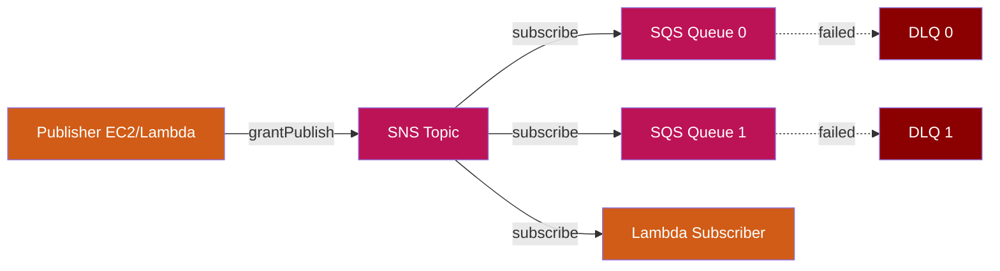

```typescript
import { PublishSubscribeSns } from './lib';

// SNS FIFO topics cannot have Lambda subscriptions — pick FIFO + SQS, or standard + Lambda.
new PublishSubscribeSns(this, 'OrderEvents', {
  subscriberQueues: 3,
  publishers: [myEc2Instance.grantPrincipal],
  subscriberLambdas: [{
    handler: 'index.handler',
    code: lambda.Code.fromAsset('lambda/notify'),
  }],
});
```

**EIP Classification:** Messaging → Message Channel → Publish-Subscribe → Message Filter → Message Broadcast

**AWS Services:** SNS, SQS, Lambda

---

#### PublishSubscribeMq
Two-way pub-sub with Amazon MQ (ActiveMQ) and correlation support for request-reply over topics.

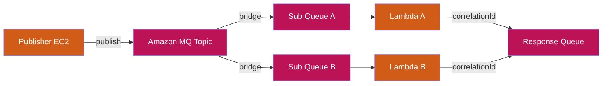

```typescript
import { PublishSubscribeMq } from './lib';
import * as secretsmanager from 'aws-cdk-lib/aws-secretsmanager';

// Secret must contain JSON with `username` and `password` keys; the broker references it
// via {{resolve:secretsmanager:...}} so cleartext never lands in the synthesised template.
const brokerSecret = new secretsmanager.Secret(this, 'MqBrokerSecret', {
  generateSecretString: {
    secretStringTemplate: JSON.stringify({ username: 'admin' }),
    generateStringKey: 'password',
    excludePunctuation: true,
  },
});

const brokerSg = new ec2.SecurityGroup(this, 'MqSg', { vpc: myVpc });

new PublishSubscribeMq(this, 'TradingEvents', {
  vpc: myVpc,
  brokerSecret,
  brokerSecurityGroup: brokerSg,
  subscribers: [
    { name: 'PricingEngine', destination: 'pricing.events',
      handler: 'index.handler', code: lambda.Code.fromAsset('lambda/pricing') },
    { name: 'RiskEngine', destination: 'risk.events',
      handler: 'index.handler', code: lambda.Code.fromAsset('lambda/risk') },
  ],
});
```

**EIP Classification:** Messaging → Message Channel → Publish-Subscribe → Correlation Identifier

**AWS Services:** Amazon MQ, SQS, Lambda

---

#### ContentBasedRouter
Routes messages to different targets based on event content inspection via EventBridge rules.

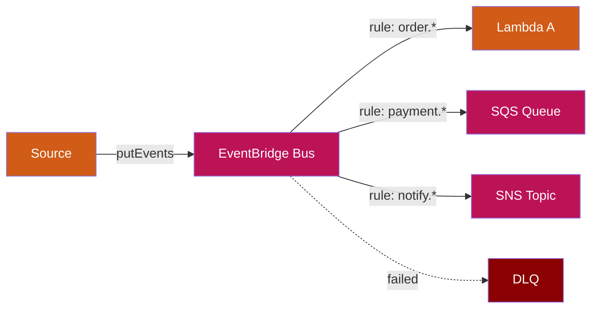

```typescript
import { ContentBasedRouter } from './lib';

new ContentBasedRouter(this, 'OrderRouter', {
  rules: [
    {
      eventPattern: { source: ['orders'], detailType: ['OrderCreated'] },
      target: 'lambda',
      lambdaConfig: { handler: 'index.handler', code: lambda.Code.fromAsset('lambda/process') },
    },
    {
      eventPattern: { source: ['orders'], detailType: ['OrderCancelled'] },
      target: 'sqs',
    },
  ],
});
```

**EIP Classification:** Messaging → Content-Based Router

**AWS Services:** EventBridge, Lambda, SQS, SNS

---

### Request-Reply Patterns

#### RequestReply
Asynchronous request-reply over SQS with correlation support.

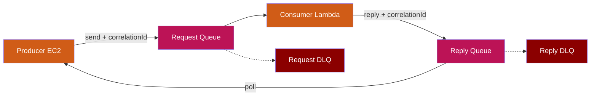

```typescript
import { RequestReply } from './lib';

new RequestReply(this, 'PaymentProcessor', {
  consumerHandler: 'index.handler',
  consumerCode: lambda.Code.fromAsset('lambda/payment'),
});
```

**EIP Classification:** Messaging → Message Channel → Polling Consumer → Correlation Identifier → Request/Reply

**AWS Services:** SQS (request + reply queues), Lambda

---

#### RequestReplyMq
Request-reply over Amazon MQ for JMS/AMQP compatibility.

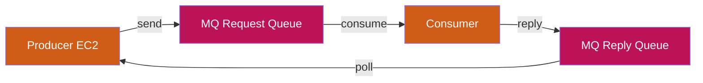

```typescript
import { RequestReplyMq } from './lib';

new RequestReplyMq(this, 'LegacyBridge', {
  vpc: myVpc,
  brokerSecret,
  brokerSecurityGroup: brokerSg,
  requestDestination: 'requests',
  replyDestination: 'replies',
});
```

**AWS Services:** Amazon MQ (ActiveMQ), SQS

---

#### RequestReplyLargePayload
Request-reply with S3 claim check for payloads exceeding 256KB.

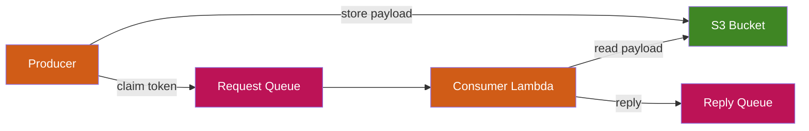

```typescript
import { RequestReplyLargePayload } from './lib';

new RequestReplyLargePayload(this, 'DocumentProcessor', {
  consumerHandler: 'index.handler',
  consumerCode: lambda.Code.fromAsset('lambda/docs'),
});
```

**EIP Classification:** Messaging → Claim Check → Request/Reply → Correlation Identifier

**AWS Services:** SQS, S3, Lambda

---

### Routing & Transformation Patterns

#### ScatterGather
Broadcasts a request to multiple recipients and correlates their responses via DynamoDB.

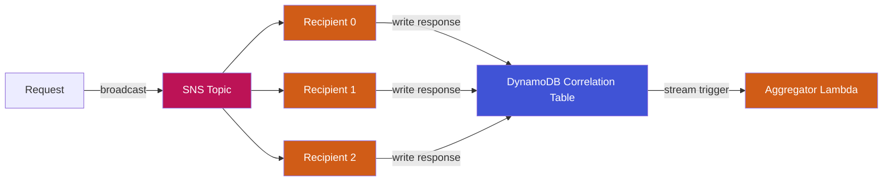

```typescript
import { ScatterGather } from './lib';

new ScatterGather(this, 'SupplierQuotes', {
  recipientCount: 4,
  recipientHandler: 'index.handler',
  recipientCode: lambda.Code.fromAsset('lambda/supplier'),
  aggregatorHandler: 'index.handler',
  aggregatorCode: lambda.Code.fromAsset('lambda/best-quote'),
  gatherTtlSeconds: 60,
});
```

**EIP Classification:** Messaging → Scatter-Gather → Broadcast → Correlation Identifier → Request/Reply

**AWS Services:** SNS, Lambda, DynamoDB (correlation table with streams)

---

#### Aggregator
Collects fine-grained messages into batches using DynamoDB state with TTL-based completion.

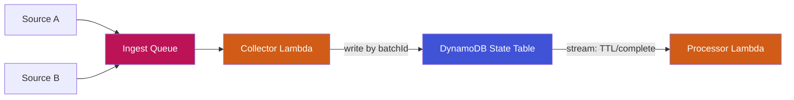

```typescript
import { Aggregator } from './lib';

new Aggregator(this, 'BatchCollector', {
  collectorHandler: 'index.handler',
  collectorCode: lambda.Code.fromAsset('lambda/collect'),
  processorHandler: 'index.handler',
  processorCode: lambda.Code.fromAsset('lambda/process-batch'),
  ttlSeconds: 300,
});
```

**EIP Classification:** Messaging → Aggregator → Polling Consumer

**AWS Services:** SQS, Lambda, DynamoDB (state table with streams + TTL)

---

#### Splitter
Breaks a composite message into individual fragments and fans out via SNS.

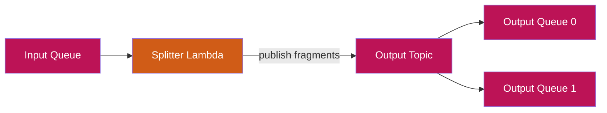

```typescript
import { Splitter } from './lib';

new Splitter(this, 'OrderSplitter', {
  splitterHandler: 'index.handler',
  splitterCode: lambda.Code.fromAsset('lambda/split'),
  outputQueueCount: 3,
});
```

**EIP Classification:** Messaging → Splitter → Polling Consumer

**AWS Services:** SQS, Lambda, SNS

---

#### Resequencer
Reorders out-of-sequence messages using DynamoDB state keyed by batchId + sequenceId.


```typescript
import { Resequencer } from './lib';

new Resequencer(this, 'OrderResequencer', {
  collectorHandler: 'index.handler',
  collectorCode: lambda.Code.fromAsset('lambda/collect'),
  dispatcherHandler: 'index.handler',
  dispatcherCode: lambda.Code.fromAsset('lambda/dispatch'),
  ttlSeconds: 120,
});
```

**EIP Classification:** Messaging → Resequencer → Polling Consumer

**AWS Services:** SQS, Lambda, DynamoDB (state table with streams + TTL)

---

#### ContentEnricher
Enriches messages by calling external services or databases before forwarding.

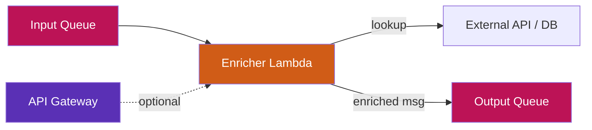

```typescript
import { ContentEnricher } from './lib';

new ContentEnricher(this, 'CustomerEnricher', {
  enricherHandler: 'index.handler',
  enricherCode: lambda.Code.fromAsset('lambda/enrich'),
  createApi: true,
});
```

**EIP Classification:** Messaging → Content Enricher → Message Channel

**AWS Services:** SQS, Lambda, API Gateway (optional)

---

### API Composition Patterns

#### ApiCompositionAppSync
Synchronous aggregation via AppSync GraphQL with unit and pipeline resolvers.

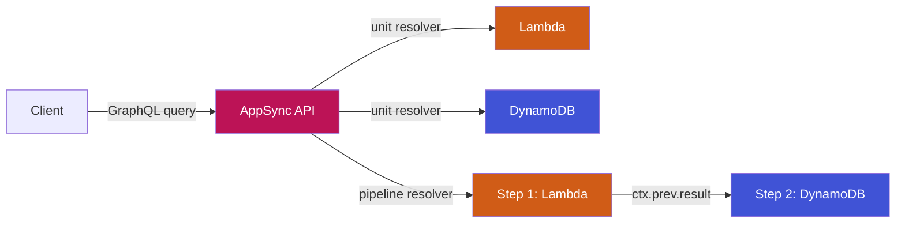

```typescript
import { ApiCompositionAppSync } from './lib';

new ApiCompositionAppSync(this, 'ProductApi', {
  schemaPath: 'schema.graphql',
  resolvers: [
    { typeName: 'Query', fieldName: 'getUser', kind: 'lambda',
      lambdaConfig: { handler: 'index.handler', code: lambda.Code.fromAsset('lambda/user') } },
    { typeName: 'Query', fieldName: 'getOrders', kind: 'dynamodb' },
  ],
  pipelineResolvers: [{
    typeName: 'Query',
    fieldName: 'getUserWithOrders',
    steps: [0, 1],  // calls resolver 0 then resolver 1 in sequence
  }],
});
```

**EIP Classification:** API Composition (Sync Aggregator) → Pipeline Resolver

**AWS Services:** AppSync, Lambda, DynamoDB

---

#### ApiCompositionApollo
Apollo Federation gateway on ECS Fargate behind an ALB.

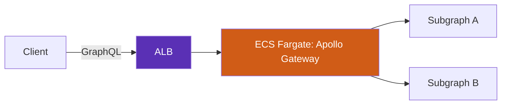

```typescript
import { ApiCompositionApollo } from './lib';

new ApiCompositionApollo(this, 'FederatedGateway', {
  vpc: myVpc,
  containerImage: ecs.ContainerImage.fromAsset('docker/apollo-gateway'),
  desiredCount: 2,
  certificate: myAcmCert,    // strongly recommended — terminates HTTPS + redirects HTTP
  publicLoadBalancer: false, // keep internal unless edge auth fronts the gateway
});
```

**AWS Services:** ECS Fargate, ALB

---

### Event & Streaming Patterns

#### EventStreaming
Kinesis-based event streaming for CQRS and audit logging.

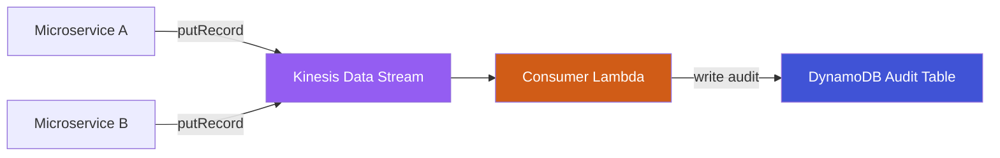

```typescript
import { EventStreaming } from './lib';

new EventStreaming(this, 'AuditStream', {
  shardCount: 2,
  consumerHandler: 'index.handler',
  consumerCode: lambda.Code.fromAsset('lambda/audit'),
  retentionPeriodHours: 168,
});
```

**EIP Classification:** Messaging → Message Channel → Event Streaming (CQRS)

**AWS Services:** Kinesis Data Streams, Lambda, DynamoDB

---

#### ClaimCheck
Stores large payloads in S3 and passes claim tokens through SQS.

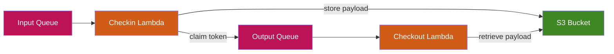

```typescript
import { ClaimCheck } from './lib';

new ClaimCheck(this, 'LargePayload', {
  checkinHandler: 'index.handler',
  checkinCode: lambda.Code.fromAsset('lambda/checkin'),
  checkoutHandler: 'index.handler',
  checkoutCode: lambda.Code.fromAsset('lambda/checkout'),
});
```

**EIP Classification:** Messaging → Claim Check

**AWS Services:** SQS, S3, Lambda

---

#### MessageReplayArchive
Archives all messages to S3 with DynamoDB metadata and provides an API for replay.

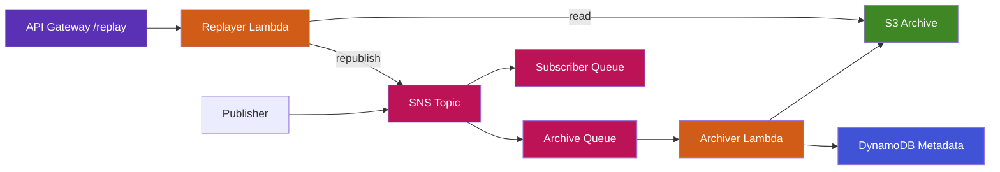

```typescript
import { MessageReplayArchive } from './lib';

new MessageReplayArchive(this, 'OrderArchive', {
  archiveHandler: 'index.handler',
  archiveCode: lambda.Code.fromAsset('lambda/archive'),
  replayHandler: 'index.handler',
  replayCode: lambda.Code.fromAsset('lambda/replay'),
  subscriberQueueCount: 2,
});
```

**Replay API Endpoints (IAM-authenticated by default — pass `apiAuthorizer` for a custom authorizer):**
- `GET /messageArchive/by-date/{date}` — retrieve archived messages by date
- `POST /messageArchive/replay/{messageId}` — republish a specific message

**AWS Services:** SNS, SQS, S3, DynamoDB, API Gateway, Lambda

---

### Saga Patterns

#### SagaChoreography
Event-driven saga with compensation chain. Each step publishes to success or failure topics. Failure propagates backward through compensation functions for full rollback.

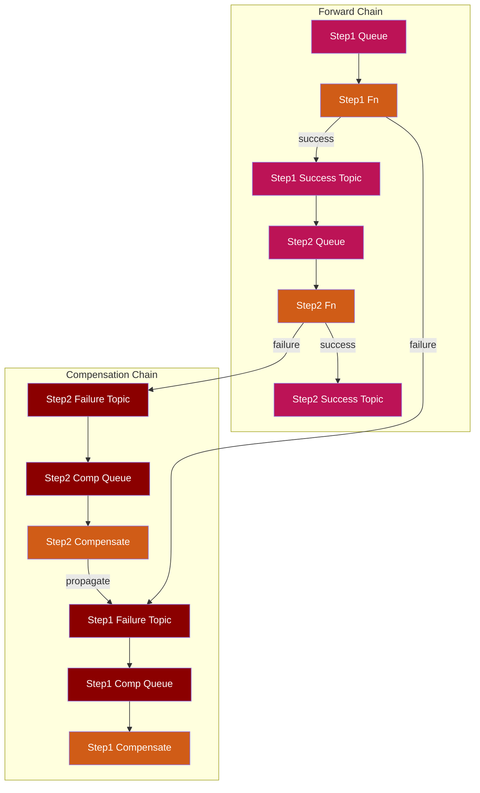

```typescript
import { SagaChoreography } from './lib';

new SagaChoreography(this, 'OrderSaga', {
  steps: [
    { name: 'ReserveStock',
      handler: 'index.handler', code: lambda.Code.fromAsset('lambda/reserve'),
      compensationHandler: 'index.handler', compensationCode: lambda.Code.fromAsset('lambda/unreserve') },
    { name: 'ChargePayment',
      handler: 'index.handler', code: lambda.Code.fromAsset('lambda/charge'),
      compensationHandler: 'index.handler', compensationCode: lambda.Code.fromAsset('lambda/refund') },
    { name: 'ShipOrder',
      handler: 'index.handler', code: lambda.Code.fromAsset('lambda/ship'),
      compensationHandler: 'index.handler', compensationCode: lambda.Code.fromAsset('lambda/cancel-ship') },
  ],
});
```

**Flow:**
```
Entry → Step1 Queue → Step1 Fn ──success──→ Step2 Queue → Step2 Fn ──success──→ Step3
                         │                                    │
                       failure                              failure
                         ↓                                    ↓
                   Step1 Failure Topic                  Step2 Failure Topic
                         ↓                                    ↓
                   Step1 Comp Queue                     Step2 Comp Queue
                         ↓                                    ↓
                   Step1 Compensate ←──propagate──── Step2 Compensate
```

**EIP Classification:** Messaging → Saga (Event Choreography) → Compensation

**AWS Services:** SNS (success + failure topics per step), SQS, Lambda

---

#### SagaOrchestration
Centrally orchestrated saga using Step Functions with try/catch compensation.

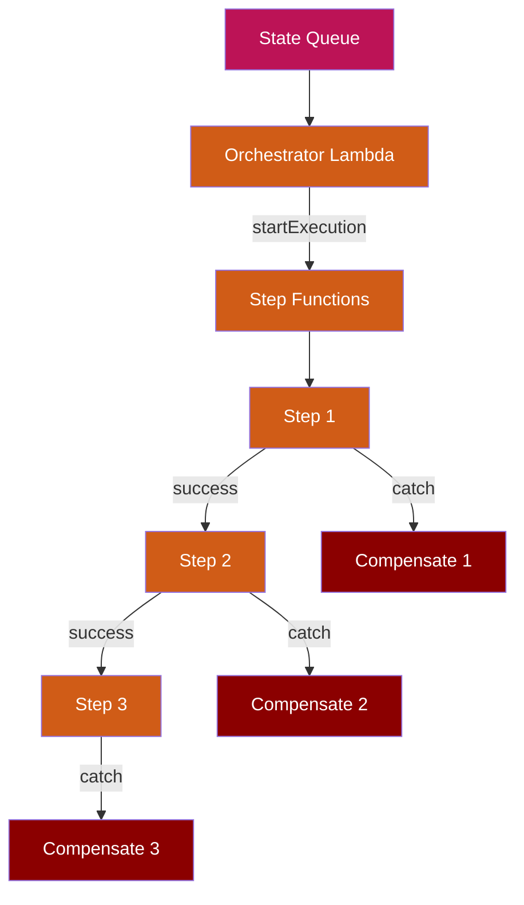

```typescript
import { SagaOrchestration } from './lib';

new SagaOrchestration(this, 'FulfilmentSaga', {
  steps: [
    { name: 'ReserveStock', handler: 'index.handler', code: lambda.Code.fromAsset('lambda/reserve'),
      compensationHandler: 'index.handler', compensationCode: lambda.Code.fromAsset('lambda/unreserve') },
    { name: 'ChargePayment', handler: 'index.handler', code: lambda.Code.fromAsset('lambda/charge'),
      compensationHandler: 'index.handler', compensationCode: lambda.Code.fromAsset('lambda/refund') },
    { name: 'ShipOrder', handler: 'index.handler', code: lambda.Code.fromAsset('lambda/ship') },
  ],
});
```

**EIP Classification:** Messaging → Saga (Event Orchestration) → Step Functions

**AWS Services:** Step Functions, SQS, Lambda

---

### Reliability & Governance Patterns

#### IdempotentReceiver
Wraps a consumer with a DynamoDB-backed dedup table so duplicate deliveries are safely ignored.

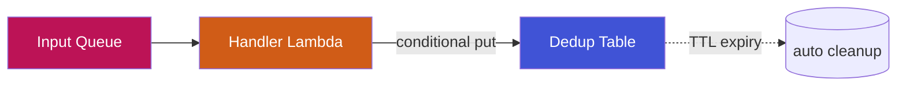

```typescript
import { IdempotentReceiver } from './lib';

new IdempotentReceiver(this, 'OrderConsumer', {
  handler: 'index.handler',
  code: lambda.Code.fromAsset('lambda/order-consumer'),
  idAttributeName: 'orderId',
  dedupTtlSeconds: 86400,
});
```

**Env injected:** `DEDUP_TABLE`, `DEDUP_ID_ATTRIBUTE`, `DEDUP_TTL_SECONDS`. Use AWS Lambda Powertools `idempotency` against the table for plug-and-play dedup.

**EIP Classification:** Messaging Endpoints → Idempotent Receiver

**AWS Services:** SQS, DynamoDB (TTL), Lambda

---

#### WireTap
Mirrors EventBridge bus traffic to an S3 audit archive via Firehose without affecting consumers.

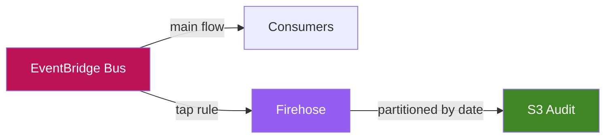

```typescript
import { WireTap } from './lib';

new WireTap(this, 'AuditTap', {
  eventBus: myBus,
  eventPattern: { source: ['orders', 'payments'] },
  archiveExpirationDays: 365,
});
```

**EIP Classification:** Systems Management → Wire Tap

**AWS Services:** EventBridge, Kinesis Firehose, S3

---

#### MessageFilter
Drops messages that do not match a predicate. Declarative EventBridge rule, no Lambda hop unless one is the target.

```typescript
import { MessageFilter } from './lib';

new MessageFilter(this, 'HighValueOrders', {
  eventBus: myBus,
  eventPattern: {
    source: ['orders'],
    detail: { totalCents: [{ numeric: ['>=', 100000] }] },
  },
  target: 'sqs',
});
```

**EIP Classification:** Message Routing → Message Filter

**AWS Services:** EventBridge, SQS / SNS / Lambda

---

#### Outbox
Transactional Outbox over DynamoDB Streams + EventBridge Pipes. Producers write outbox rows in the same transaction as business state; the pipe relays them to SNS.

```mermaid
graph LR
    APP[App Code] -->|"transactWrite (state + outbox)"| DDB[Outbox Table]
    DDB -->|streams: INSERT only| PIPE[EventBridge Pipe]
    PIPE --> TOPIC[SNS Topic]
    PIPE -.->|on failure| DLQ[Pipe DLQ]
    style DDB fill:#4053D6,color:#fff
    style PIPE fill:#945DF2,color:#fff
    style TOPIC fill:#BC1356,color:#fff
    style DLQ fill:#8B0000,color:#fff
```

```typescript
import { Outbox } from './lib';

const outbox = new Outbox(this, 'OrderOutbox');
// Producer writes business state + outbox row in one TransactWriteItems.
new CfnOutput(this, 'OutboxTable', { value: outbox.outboxTable.tableName });
new CfnOutput(this, 'OutboxTopic', { value: outbox.topic.topicArn });
```

**EIP Classification:** Modern Cloud → Transactional Outbox

**AWS Services:** DynamoDB (Streams), EventBridge Pipes, SNS, SQS (DLQ)

---

#### MessageTranslator
Format / schema conversion. Caller-supplied translator Lambda receives source-format messages and emits canonical-format messages on the output queue.

```typescript
import { MessageTranslator } from './lib';

new MessageTranslator(this, 'PartnerOrderMapper', {
  translatorHandler: 'index.handler',
  translatorCode: lambda.Code.fromAsset('lambda/translate'),
  sourceSchema: 'xml/partner-order/v1',
  targetSchema: 'json/canonical-order/v2',
  schemaRegistryName: 'integration-registry',
  schemaName: 'CanonicalOrder',
});
```

**Env injected:** `OUTPUT_QUEUE_URL`, `SOURCE_SCHEMA`, `TARGET_SCHEMA`, `SCHEMA_REGISTRY_NAME`, `SCHEMA_NAME`.

**EIP Classification:** Message Transformation → Message Translator

**AWS Services:** SQS, Lambda (+ optional Glue Schema Registry)

---

#### FileTransfer
SFTP/FTPS file ingestion via AWS Transfer Family into an S3 landing bucket, fanned out via EventBridge with an optional ingestion Lambda.

```mermaid
graph LR
    PRT[Partner SFTP Client] --> SRV[Transfer Family Server]
    SRV --> LAND[S3 Landing Bucket]
    LAND --> EB[EventBridge]
    EB --> ING[Ingestion Lambda]
    style SRV fill:#5A30B5,color:#fff
    style LAND fill:#3F8624,color:#fff
    style EB fill:#BC1356,color:#fff
    style ING fill:#D05C17,color:#fff
```

```typescript
import { FileTransfer } from './lib';

const ft = new FileTransfer(this, 'PartnerSftp', {
  protocol: 'SFTP',
  fileRetentionDays: 30,
  ingestionHandler: 'index.handler',
  ingestionCode: lambda.Code.fromAsset('lambda/ingest'),
});
// Add SFTP users separately, e.g.:
// new transfer.CfnUser(this, 'PartnerA', {
//   serverId: ft.server.attrServerId,
//   userName: 'partner-a',
//   role: ft.userRole.roleArn,
//   homeDirectory: `/${ft.landingBucket.bucketName}/partner-a`,
// });
```

**EIP Classification:** Integration Styles → File Transfer

**AWS Services:** AWS Transfer Family, S3, EventBridge, Lambda

---

#### Throttling
Two-layer rate limiter: SQS-fronted worker with reserved concurrency (downstream protection) and an optional API Gateway facade with a usage plan (partner protection).

```typescript
import { Throttling } from './lib';

new Throttling(this, 'PartnerApiThrottle', {
  workerHandler: 'index.handler',
  workerCode: lambda.Code.fromAsset('lambda/call-partner'),
  workerReservedConcurrency: 10,
  createApi: true,
  rateLimitRps: 50,
  burstLimit: 100,
  dailyQuota: 1_000_000,
});
```

**EIP Classification:** Modern Cloud → Throttling / Rate Limiter

**AWS Services:** SQS, Lambda (reserved concurrency), API Gateway (usage plans)

---

#### CircuitBreaker
DynamoDB-backed breaker state in front of a downstream call. Caller's Lambda reads/writes breaker state with the surfaced env vars; AWS Lambda Powertools `circuit-breaker` style logic plugs straight in.

```typescript
import { CircuitBreaker } from './lib';

new CircuitBreaker(this, 'PaymentGatewayBreaker', {
  handler: 'index.handler',
  code: lambda.Code.fromAsset('lambda/charge'),
  failureThreshold: 5,
  cooldownSeconds: 30,
  breakerKey: 'payment-gateway-v1',
});
```

**EIP Classification:** Modern Cloud → Circuit Breaker

**AWS Services:** SQS, DynamoDB (TTL), Lambda

---

#### RetryWithBackoff
SQS-driven retry with configurable visibility-timeout backoff. Worker throws on transient failure; SQS redrives. Worker may extend visibility for adaptive exponential backoff.

```typescript
import { RetryWithBackoff } from './lib';

new RetryWithBackoff(this, 'PartnerWebhook', {
  workerHandler: 'index.handler',
  workerCode: lambda.Code.fromAsset('lambda/webhook'),
  initialVisibilityTimeoutSeconds: 30,
  backoffMultiplier: 2,
  maxVisibilityTimeoutSeconds: 900,
  maxAttempts: 6,
});
```

**Env injected:** `QUEUE_URL`, `RETRY_INITIAL_SECONDS`, `RETRY_MULTIPLIER`, `RETRY_MAX_SECONDS`, `RETRY_MAX_ATTEMPTS`.

**EIP Classification:** Modern Cloud → Retry with Backoff

**AWS Services:** SQS, Lambda

---

#### ProcessManager
Linear, centrally orchestrated workflow without compensation. Use when "stop on failure" is acceptable — approval workflows, ingestion pipelines, BPM-lite. Reach for `SagaOrchestration` if you need rollback.

```typescript
import { ProcessManager } from './lib';

new ProcessManager(this, 'OnboardingFlow', {
  steps: [
    { name: 'Validate', handler: 'index.handler', code: lambda.Code.fromAsset('lambda/validate'), maxRetries: 2 },
    { name: 'Provision', handler: 'index.handler', code: lambda.Code.fromAsset('lambda/provision') },
    { name: 'Notify',   handler: 'index.handler', code: lambda.Code.fromAsset('lambda/notify') },
  ],
});
```

**EIP Classification:** Message Routing → Process Manager

**AWS Services:** Step Functions, SQS, Lambda

---

#### RoutingSlip
Producer-supplied itinerary array dictates the order of steps at runtime. Step Functions Map iterates the slip; a dispatcher invokes the matching step's Lambda.

```typescript
import { RoutingSlip } from './lib';

new RoutingSlip(this, 'OrderSlip', {
  steps: [
    { name: 'validate', handler: 'index.handler', code: lambda.Code.fromAsset('lambda/validate') },
    { name: 'enrich',   handler: 'index.handler', code: lambda.Code.fromAsset('lambda/enrich') },
    { name: 'publish',  handler: 'index.handler', code: lambda.Code.fromAsset('lambda/publish') },
  ],
});
// Producer sends:
//   { "itinerary": ["validate", "enrich", "publish"], "payload": { ... } }
```

**EIP Classification:** Message Routing → Routing Slip

**AWS Services:** Step Functions (Map), SQS, Lambda

---

## Implementation Guide

This section walks through how to implement each pattern end-to-end. It explains what the construct creates, what you need to provide, and how messages flow through the system.

---

### Implementing Request-Reply

**Scenario:** Your order service (EC2) needs to send a payment request and wait for a response.

**What the construct creates for you:**

| Resource | Name | Purpose |
|---|---|---|
| SQS Queue | `RequestQueue` | Producer sends payment requests here |
| SQS Queue | `ReplyQueue` | Consumer sends responses back here |
| SQS Queue | `RequestDLQ` | Failed requests land here after 3 attempts |
| SQS Queue | `ReplyDLQ` | Failed replies land here after 3 attempts |
| Lambda | `Consumer` | Your business logic that processes requests |
| IAM Permissions | — | Consumer can read RequestQueue + write to ReplyQueue |
| Event Source | — | Consumer is automatically triggered by RequestQueue |

**What you provide:**

```typescript
new RequestReply(this, 'PaymentProcessor', {
  // REQUIRED: Your Lambda handler that processes the request and sends a reply
  consumerHandler: 'index.handler',
  consumerCode: lambda.Code.fromAsset('lambda/payment'),

  // OPTIONAL: Override defaults
  consumerRuntime: lambda.Runtime.NODEJS_20_X,
  deadLetterQueue: {
    maxReceiveCount: 5,        // retry 5 times before DLQ (default: 3)
    retentionPeriodDays: 7,    // keep DLQ messages 7 days (default: 14)
  },
});
```

**Your consumer Lambda must:**

1. Read the request from the SQS event
2. Process it (call payment gateway, validate, etc.)
3. Send the response to the reply queue using the `REPLY_QUEUE_URL` environment variable
4. Include the `correlationId` from the original request so the producer can match it

```typescript
// lambda/payment/index.ts
import { SQSEvent } from 'aws-lambda';
import { SQSClient, SendMessageCommand } from '@aws-sdk/client-sqs';

const sqs = new SQSClient();

export const handler = async (event: SQSEvent) => {
  for (const record of event.Records) {
    const request = JSON.parse(record.body);

    // Your business logic
    const result = await processPayment(request);

    // Send reply with the same correlationId
    await sqs.send(new SendMessageCommand({
      QueueUrl: process.env.REPLY_QUEUE_URL,
      MessageBody: JSON.stringify({
        correlationId: request.correlationId,
        status: result.status,
        transactionId: result.transactionId,
      }),
    }));
  }
};
```

**Your producer (EC2/ECS app) must:**

1. Generate a unique `correlationId`
2. Send the request to the RequestQueue
3. Poll the ReplyQueue filtering by `correlationId`

```typescript
// Producer-side code (runs on EC2/ECS)
import { SQSClient, SendMessageCommand, ReceiveMessageCommand } from '@aws-sdk/client-sqs';
import { randomUUID } from 'crypto';

const sqs = new SQSClient();
const correlationId = randomUUID();

// Send request
await sqs.send(new SendMessageCommand({
  QueueUrl: requestQueueUrl,  // from stack outputs
  MessageBody: JSON.stringify({
    correlationId,
    orderId: 'ORD-123',
    amount: 99.99,
  }),
}));

// Poll for reply (with timeout)
const reply = await pollForReply(replyQueueUrl, correlationId, timeoutMs: 30000);
```

**How to get the queue URLs into your producer:**

```typescript
// In your CDK stack
const rr = new RequestReply(this, 'PaymentProcessor', { ... });

// Export as stack outputs so your producer app can read them
new CfnOutput(this, 'RequestQueueUrl', { value: rr.requestQueue.queueUrl });
new CfnOutput(this, 'ReplyQueueUrl', { value: rr.replyQueue.queueUrl });

// Or pass to an EC2 instance via user data / SSM parameter
new ssm.StringParameter(this, 'RequestQueueParam', {
  parameterName: '/myapp/payment/request-queue-url',
  stringValue: rr.requestQueue.queueUrl,
});
```

---

### Implementing Publish-Subscribe (SNS)

**Scenario:** Your order service publishes events and multiple downstream services need to react independently.

**What the construct creates:**

| Resource | Purpose |
|---|---|
| SNS Topic | Central event bus — all events published here |
| SQS Queue 0..N | One per subscriber — each gets a copy of every message |
| SQS DLQ 0..N | One per subscriber queue — catches processing failures |
| Lambda 0..N | Optional subscriber functions triggered by their queue |
| IAM Permissions | Publishers can write to topic, queues subscribe to topic |

**What you provide:**

```typescript
const orderEvents = new PublishSubscribeSns(this, 'OrderEvents', {
  // How many independent SQS subscriber queues?
  subscriberQueues: 3,

  // Which services can publish to this topic?
  publishers: [orderService.role, inventoryService.role],

  // Optional: Lambda functions that auto-subscribe
  subscriberLambdas: [{
    handler: 'index.handler',
    code: lambda.Code.fromAsset('lambda/send-email'),
  }],
});

// Queue 0 → Inventory service polls this
// Queue 1 → Analytics service polls this
// Queue 2 → Audit service polls this
// Lambda 0 → Email notification (auto-triggered)

// Export queue URLs so each downstream service knows where to poll
new CfnOutput(this, 'InventoryQueueUrl', { value: orderEvents.queues[0].queueUrl });
new CfnOutput(this, 'AnalyticsQueueUrl', { value: orderEvents.queues[1].queueUrl });
new CfnOutput(this, 'AuditQueueUrl', { value: orderEvents.queues[2].queueUrl });
```

**Your publisher sends events like this:**

```typescript
import { SNSClient, PublishCommand } from '@aws-sdk/client-sns';

await new SNSClient().send(new PublishCommand({
  TopicArn: process.env.ORDER_TOPIC_ARN,  // from stack outputs
  Message: JSON.stringify({ orderId: 'ORD-123', status: 'CREATED' }),
  MessageAttributes: {
    eventType: { DataType: 'String', StringValue: 'OrderCreated' },
  },
}));
```

---

### Implementing Scatter-Gather

**Scenario:** You need quotes from 4 suppliers and want to pick the best one.

**What the construct creates:**

| Resource | Purpose |
|---|---|
| SNS Topic | Broadcasts the quote request to all recipients |
| Lambda Recipient 0..N | Each calls a different supplier API |
| DynamoDB Table | Correlation table — tracks which responses have arrived |
| DynamoDB Stream | Triggers aggregator when new responses arrive |
| Lambda Aggregator | Checks if all responses arrived, picks the best |

**What you provide:**

```typescript
new ScatterGather(this, 'SupplierQuotes', {
  recipientCount: 4,
  gatherTtlSeconds: 60,  // timeout if not all respond in 60s

  // Each recipient Lambda receives the broadcast and writes its response
  recipientHandler: 'index.handler',
  recipientCode: lambda.Code.fromAsset('lambda/call-supplier'),

  // Aggregator fires when all 4 respond (or TTL expires)
  aggregatorHandler: 'index.handler',
  aggregatorCode: lambda.Code.fromAsset('lambda/pick-best'),
});
```

**Your recipient Lambda must:**

```typescript
// lambda/call-supplier/index.ts
import { DynamoDBClient, PutItemCommand } from '@aws-sdk/client-dynamodb';

const ddb = new DynamoDBClient();

export const handler = async (event: any) => {
  const request = JSON.parse(event.Records[0].Sns.Message);

  // Call your supplier API
  const quote = await callSupplierApi(request);

  // Write response to correlation table
  await ddb.send(new PutItemCommand({
    TableName: process.env.CORRELATION_TABLE,
    Item: {
      correlationId: { S: request.correlationId },
      recipientId: { S: process.env.RECIPIENT_ID },
      response: { S: JSON.stringify(quote) },
      ttl: { N: String(Math.floor(Date.now() / 1000) + Number(process.env.TTL_SECONDS)) },
    },
  }));
};
```

**Your aggregator Lambda receives DynamoDB stream events:**

```typescript
// lambda/pick-best/index.ts
export const handler = async (event: any) => {
  // Check how many responses exist for this correlationId
  // If all EXPECTED_RESPONSES have arrived, pick the best quote
  // If TTL expired, work with whatever responses you have
};
```

---

### Implementing Saga Choreography

**Scenario:** Order fulfilment requires Reserve Stock → Charge Payment → Ship. If any step fails, all previous steps must roll back.

**What the construct creates per step:**

| Resource | Purpose |
|---|---|
| SNS Success Topic | Step publishes here on success → triggers next step |
| SNS Failure Topic | Step publishes here on failure → triggers compensation |
| SQS Queue | Receives messages from previous step's success topic |
| SQS Compensation Queue | Receives messages from this step's failure topic |
| Lambda Function | Your step business logic |
| Lambda Compensation | Your rollback logic |

**What each step Lambda must do:**

```typescript
// lambda/charge/index.ts — Step function
import { SNSClient, PublishCommand } from '@aws-sdk/client-sns';

const sns = new SNSClient();

export const handler = async (event: any) => {
  const message = JSON.parse(event.Records[0].body);

  try {
    const result = await chargePayment(message);

    // SUCCESS → publish to success topic (triggers next step)
    await sns.send(new PublishCommand({
      TopicArn: process.env.SUCCESS_TOPIC_ARN,
      Message: JSON.stringify({ ...message, paymentId: result.id }),
    }));
  } catch (error) {
    // FAILURE → publish to failure topic (triggers compensation)
    await sns.send(new PublishCommand({
      TopicArn: process.env.FAILURE_TOPIC_ARN,
      Message: JSON.stringify({ ...message, error: error.message }),
    }));
  }
};
```

```typescript
// lambda/refund/index.ts — Compensation function
import { SNSClient, PublishCommand } from '@aws-sdk/client-sns';

const sns = new SNSClient();

export const handler = async (event: any) => {
  const message = JSON.parse(event.Records[0].body);

  // Undo this step
  await refundPayment(message.paymentId);

  // Propagate failure backward to previous step's compensation
  if (process.env.PREV_FAILURE_TOPIC_ARN) {
    await sns.send(new PublishCommand({
      TopicArn: process.env.PREV_FAILURE_TOPIC_ARN,
      Message: JSON.stringify(message),
    }));
  }
};
```

**Environment variables injected automatically:**

| Variable | Available In | Value |
|---|---|---|
| `SUCCESS_TOPIC_ARN` | Step functions | This step's success topic |
| `FAILURE_TOPIC_ARN` | Step functions | This step's failure topic |
| `STEP_NAME` | Step functions | Name of this step |
| `PREV_FAILURE_TOPIC_ARN` | Compensation functions | Previous step's failure topic (empty for step 1) |

---

## Accessing Underlying Resources

Every construct exposes its AWS resources as public properties for custom wiring:

```typescript
const pubsub = new PublishSubscribeSns(this, 'Events', { subscriberQueues: 2 });

// Grant another service publish access
pubsub.grantPublish(myOtherLambda);

// Access queues directly
pubsub.queues[0].grantConsumeMessages(myWorker);

// Reference the topic ARN
new CfnOutput(this, 'TopicArn', { value: pubsub.topic.topicArn });
```

## Common Configuration

All constructs accept `BasePatternProps`:

| Property | Type | Default | Description |
|---|---|---|---|
| `removalPolicy` | `RemovalPolicy` | `DESTROY` | CloudFormation removal policy for all resources |
| `deadLetterQueue.maxReceiveCount` | `number` | `3` | Max receives before sending to DLQ (honoured across all patterns) |
| `deadLetterQueue.retentionPeriodDays` | `number` | `14` | DLQ message retention (honoured across all patterns) |
| `logRetention` | `logs.RetentionDays` | `ONE_MONTH` | CloudWatch log retention applied to every Lambda |
| `lambdaTimeout` | `Duration` | `30s` | Default Lambda timeout for functions created by the pattern. Every SQS queue that feeds a Lambda gets a visibility timeout of 6× this value automatically (the AWS-recommended ratio), so raising it never trips Lambda's "function timeout must not exceed queue visibility timeout" check at deploy. `RetryWithBackoff` is the exception: its visibility timeout is the retry schedule (`initialVisibilityTimeoutSeconds`), so it fails synth with a clear message if you set `lambdaTimeout` higher than that. |

All SQS queues are `SQS_MANAGED` encrypted with `enforceSSL: true`. All S3 buckets are `BLOCK_ALL` public access, `S3_MANAGED` encrypted, with `enforceSSL: true`. SNS topics use `enforceSSL: true`. DynamoDB tables enable point-in-time recovery. AppSync defaults to `IAM` auth; API Gateway endpoints created by `ContentEnricher`, `MessageReplayArchive` and `Throttling` default to `IAM` auth unless an authorizer is supplied. `ApiCompositionApollo` keeps its load balancer internal unless `publicLoadBalancer: true` is set together with a `certificate`.

## Pattern Selection Guide

| Need | Pattern | Construct |
|---|---|---|
| Fan-out to multiple consumers | Publish-Subscribe | `PublishSubscribeSns` |
| JMS/AMQP compatibility | Publish-Subscribe | `PublishSubscribeMq` |
| Route by message content | Content-Based Router | `ContentBasedRouter` |
| Synchronous call + response | Request-Reply | `RequestReply` |
| Payloads > 256KB | Claim Check | `ClaimCheck` or `RequestReplyLargePayload` |
| Broadcast + collect responses | Scatter-Gather | `ScatterGather` |
| Collect messages into batches | Aggregator | `Aggregator` |
| Break composite messages apart | Splitter | `Splitter` |
| Reorder out-of-sequence messages | Resequencer | `Resequencer` |
| Add data from external sources | Content Enricher | `ContentEnricher` |
| Aggregate multiple APIs | API Composition | `ApiCompositionAppSync` |
| GraphQL federation | API Composition | `ApiCompositionApollo` |
| CQRS / audit trail | Event Streaming | `EventStreaming` |
| Multi-step transaction (decoupled) | Saga Choreography | `SagaChoreography` |
| Multi-step transaction (central) | Saga Orchestration | `SagaOrchestration` |
| Message archival + replay | Message Replay | `MessageReplayArchive` |
| At-least-once dedup | Idempotent Receiver | `IdempotentReceiver` |
| Compliance / audit mirroring | Wire Tap | `WireTap` |
| Drop messages by predicate | Message Filter | `MessageFilter` |
| Reliable publish-after-commit | Transactional Outbox | `Outbox` |
| Format / schema mapping | Message Translator | `MessageTranslator` |
| Legacy SFTP/FTPS ingestion | File Transfer | `FileTransfer` |
| Rate limit downstream / partner | Throttling | `Throttling` |
| Protect downstream from failure | Circuit Breaker | `CircuitBreaker` |
| Configurable retry policy | Retry with Backoff | `RetryWithBackoff` |
| Linear workflow (no compensation) | Process Manager | `ProcessManager` |
| Producer-defined dynamic workflow | Routing Slip | `RoutingSlip` |

## Contributing

Contributions are welcome — new patterns, bug fixes, doc improvements, and additional integration tests are all in scope.

### Project layout

```
.
├── bin/app.ts          # CDK entry point (library consumers wire their own stacks)
├── lib/
│   ├── index.ts        # Public barrel — every pattern is exported here
│   ├── types.ts        # BasePatternProps, DLQ/log/timeout defaults
│   └── patterns/       # One file per EIP construct
├── test/
│   ├── unit/           # Tier 1 — fast aws-cdk-lib/assertions tests
│   └── integ/          # Tier 2 — opt-in real-deploy integration tests
├── security/           # cdk-nag harness + summariser — `npm run security:nag:summary`
├── examples/           # Scripted walkthroughs — path-2-with-agents/ is the five-interface BizTalk demo
├── skills/             # Canonical Agent Skills — edit these, not .kiro/ or .claude/
├── agents/             # Canonical agent prompts + per-tool targets
├── scripts/            # sync-agent-config.mjs — regenerates .kiro/ and .claude/
├── .kiro/ .claude/     # Generated from skills/ and agents/ — do not edit
├── .github/workflows/  # CI: check:agents, build, unit tests
├── package.json
├── tsconfig.json
└── jest.config.ts
```

### Local development

```bash
git clone https://github.com/aws-samples/sample-enterprise-integration-patterns-cdk.git
cd sample-enterprise-integration-patterns-cdk
npm ci
npm run build      # tsc — must pass before opening a PR
npm test           # Tier 1 unit tests — required on every PR
```

**Requirements:** Node.js 20+, AWS CDK CLI v2, TypeScript 5.x.

### Tests

Two-tier suite — see `test/README.md` for the full rationale.

| Tier | Command | When |
|---|---|---|
| Unit (CFN assertions) | `npm test` | Every PR — must pass |
| Hosted integration | `RUN_HOSTED_INTEG=1 AWS_REGION=us-east-1 INTEG_TEST_ACCOUNT=<acct> npm run test:integ` | Nightly / pre-merge to main |
| Both | `RUN_HOSTED_INTEG=1 ... npm run test:all` | Release prep |

Coverage gates: **80% lines / 70% branches** for the unit tier.

### Adding a new pattern

1. **Construct** — `lib/patterns/<pattern>.ts`. Extend `BasePatternProps` from `lib/types.ts` so removal policy, DLQ config, log retention, and Lambda timeout are inherited.
2. **Export** — add the construct and its props interface to `lib/index.ts`.
3. **Unit test** — `test/unit/<pattern>.test.ts`. Use helpers in `test/unit/helpers.ts` (`assertAllQueuesSecure`, `assertAllBucketsSecure`, `assertAllTablesPointInTimeRecovery`) for security-default assertions. Cover:
   - Resource counts.
   - Key prop wiring (env vars, encryption, DLQ).
   - IAM least privilege.
   - Anti-pattern errors the construct rejects.
4. **Integ test (optional)** — `test/integ/<pattern>.integ.test.ts` only if runtime behaviour can't be proven by CFN assertions alone (e.g. correlation round-trips, state-machine completion).
5. **README** — add a section under the appropriate category with a Mermaid diagram, TypeScript usage example, EIP classification, and the AWS services involved. Match the existing pattern entries' style.
6. **Pattern selector** — add a row to the "Pattern Selection Guide" table at the end of this README.

### Coding conventions

- TypeScript strict mode (see `tsconfig.json`).
- One construct per file under `lib/patterns/`.
- All Lambdas and queues created by a pattern must respect `BasePatternProps` (no hardcoded retention / timeout).
- SQS queues default to `QueueEncryption.SQS_MANAGED`; opt out only with explicit justification in code review.
- Use inclusive language — no `master/slave`, `whitelist/blacklist` (prefer `primary/replica`, `allowlist/denylist`).

### Pull requests

See [CONTRIBUTING.md](CONTRIBUTING.md) for the full contribution process. In short:

- Branch from `main`.
- Title: imperative mood, scoped — e.g. `Add CircuitBreaker pattern`, `Fix DLQ wiring in Aggregator`.
- Description should reference the EIP being implemented and any AWS services added.
- Required checks: `npm run build`, `npm run check:agents`, `npm test`. Hosted integ tests are not required per-PR.
- Squash on merge for single-pattern additions; merge commit for multi-pattern refactors.

### Reporting issues

Open a GitHub issue with:
- Pattern name (if applicable).
- CDK version, Node version, OS.
- Minimal reproduction — usage snippet + the synth/deploy error.

For security issues, do not open a public issue — follow the
[AWS Vulnerability Reporting](https://aws.amazon.com/security/vulnerability-reporting/) process instead.

## License

This library is licensed under the MIT-0 License. See the [LICENSE](LICENSE) file.
