# Patterns Reference

Every construct in the library, grouped by category. Each entry has a diagram of what the construct provisions, a usage example with real props, its position in the Enterprise Integration Patterns taxonomy, and the AWS services underneath.

For which construct to pick, start with the [Pattern Selection Guide](../README.md#pattern-selection-guide) in the README. For end-to-end worked examples, see the [Implementation Guide](implementation-guide.md).

### Messaging Patterns

#### PublishSubscribeSns
One-way fan-out via SNS to multiple SQS queues and Lambda subscribers.

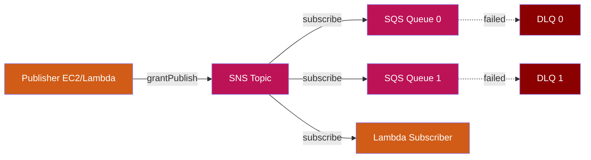

```typescript
import { PublishSubscribeSns } from './lib';

// SNS FIFO topics cannot have Lambda subscriptions — pick FIFO + SQS, or standard + Lambda.
new PublishSubscribeSns(this, 'OrderEvents', {
  subscriberQueues: 3,
  publishers: [myEc2Instance.grantPrincipal],
  subscriberLambdas: [{
    handler: 'index.handler',
    code: lambda.Code.fromAsset('lambda/notify'),
  }],
});
```

**EIP Classification:** Messaging → Message Channel → Publish-Subscribe → Message Filter → Message Broadcast

**AWS Services:** SNS, SQS, Lambda

---

#### PublishSubscribeMq
Two-way pub-sub with Amazon MQ (ActiveMQ) and correlation support for request-reply over topics.

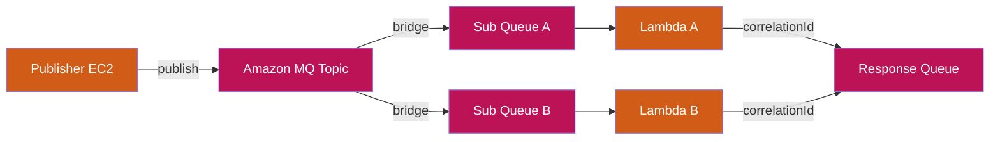

```typescript
import { PublishSubscribeMq } from './lib';
import * as secretsmanager from 'aws-cdk-lib/aws-secretsmanager';

// Secret must contain JSON with `username` and `password` keys; the broker references it
// via {{resolve:secretsmanager:...}} so cleartext never lands in the synthesised template.
const brokerSecret = new secretsmanager.Secret(this, 'MqBrokerSecret', {
  generateSecretString: {
    secretStringTemplate: JSON.stringify({ username: 'admin' }),
    generateStringKey: 'password',
    excludePunctuation: true,
  },
});

const brokerSg = new ec2.SecurityGroup(this, 'MqSg', { vpc: myVpc });

new PublishSubscribeMq(this, 'TradingEvents', {
  vpc: myVpc,
  brokerSecret,
  brokerSecurityGroup: brokerSg,
  subscribers: [
    { name: 'PricingEngine', destination: 'pricing.events',
      handler: 'index.handler', code: lambda.Code.fromAsset('lambda/pricing') },
    { name: 'RiskEngine', destination: 'risk.events',
      handler: 'index.handler', code: lambda.Code.fromAsset('lambda/risk') },
  ],
});
```

**EIP Classification:** Messaging → Message Channel → Publish-Subscribe → Correlation Identifier

**AWS Services:** Amazon MQ, SQS, Lambda

---

#### ContentBasedRouter
Routes messages to different targets based on event content inspection via EventBridge rules.

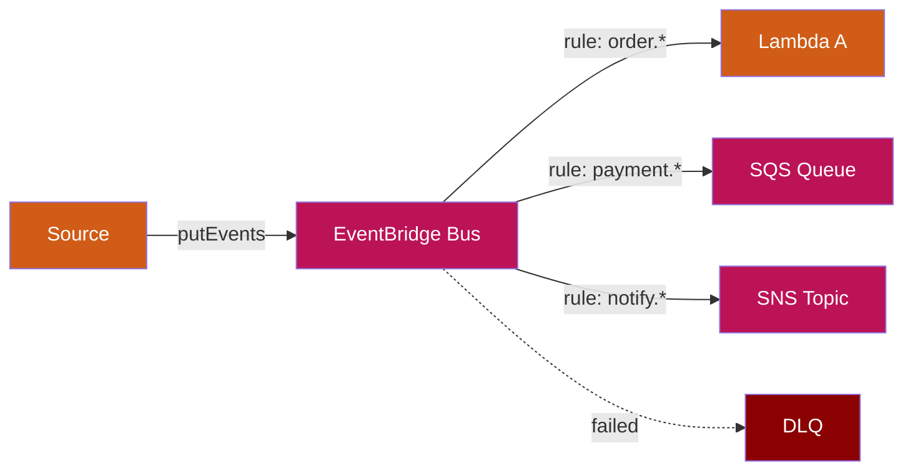

```typescript
import { ContentBasedRouter } from './lib';

new ContentBasedRouter(this, 'OrderRouter', {
  rules: [
    {
      eventPattern: { source: ['orders'], detailType: ['OrderCreated'] },
      target: 'lambda',
      lambdaConfig: { handler: 'index.handler', code: lambda.Code.fromAsset('lambda/process') },
    },
    {
      eventPattern: { source: ['orders'], detailType: ['OrderCancelled'] },
      target: 'sqs',
    },
  ],
});
```

**EIP Classification:** Messaging → Content-Based Router

**AWS Services:** EventBridge, Lambda, SQS, SNS

---

### Request-Reply Patterns

#### RequestReply
Asynchronous request-reply over SQS with correlation support.

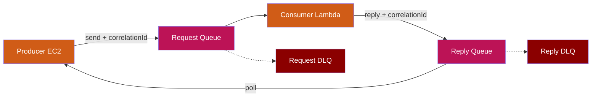

```typescript
import { RequestReply } from './lib';

new RequestReply(this, 'PaymentProcessor', {
  consumerHandler: 'index.handler',
  consumerCode: lambda.Code.fromAsset('lambda/payment'),
});
```

**EIP Classification:** Messaging → Message Channel → Polling Consumer → Correlation Identifier → Request/Reply

**AWS Services:** SQS (request + reply queues), Lambda

---

#### RequestReplyMq
Request-reply over Amazon MQ for JMS/AMQP compatibility.

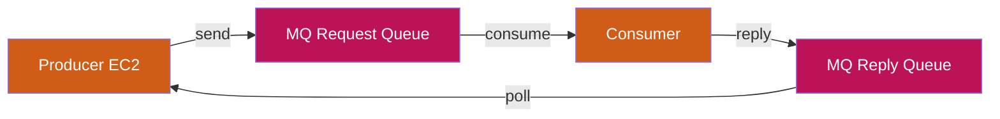

```typescript
import { RequestReplyMq } from './lib';

new RequestReplyMq(this, 'LegacyBridge', {
  vpc: myVpc,
  brokerSecret,
  brokerSecurityGroup: brokerSg,
  requestDestination: 'requests',
  replyDestination: 'replies',
});
```

**AWS Services:** Amazon MQ (ActiveMQ), SQS

---

#### RequestReplyLargePayload
Request-reply with S3 claim check for payloads exceeding 256KB.

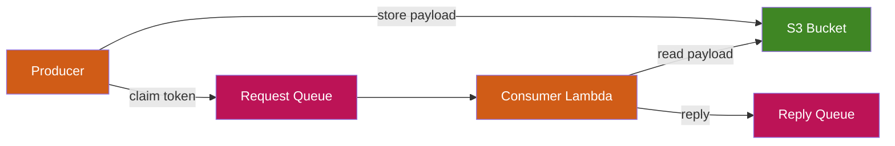

```typescript
import { RequestReplyLargePayload } from './lib';

new RequestReplyLargePayload(this, 'DocumentProcessor', {
  consumerHandler: 'index.handler',
  consumerCode: lambda.Code.fromAsset('lambda/docs'),
});
```

**EIP Classification:** Messaging → Claim Check → Request/Reply → Correlation Identifier

**AWS Services:** SQS, S3, Lambda

---

### Routing & Transformation Patterns

#### ScatterGather
Broadcasts a request to multiple recipients and correlates their responses via DynamoDB.

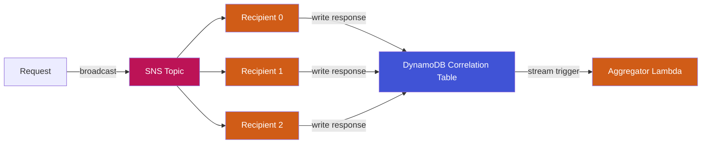

```typescript
import { ScatterGather } from './lib';

new ScatterGather(this, 'SupplierQuotes', {
  recipientCount: 4,
  recipientHandler: 'index.handler',
  recipientCode: lambda.Code.fromAsset('lambda/supplier'),
  aggregatorHandler: 'index.handler',
  aggregatorCode: lambda.Code.fromAsset('lambda/best-quote'),
  gatherTtlSeconds: 60,
});
```

**EIP Classification:** Messaging → Scatter-Gather → Broadcast → Correlation Identifier → Request/Reply

**AWS Services:** SNS, Lambda, DynamoDB (correlation table with streams)

---

#### Aggregator
Collects fine-grained messages into batches using DynamoDB state with TTL-based completion.

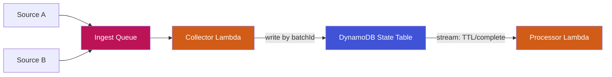

```typescript
import { Aggregator } from './lib';

new Aggregator(this, 'BatchCollector', {
  collectorHandler: 'index.handler',
  collectorCode: lambda.Code.fromAsset('lambda/collect'),
  processorHandler: 'index.handler',
  processorCode: lambda.Code.fromAsset('lambda/process-batch'),
  ttlSeconds: 300,
});
```

**EIP Classification:** Messaging → Aggregator → Polling Consumer

**AWS Services:** SQS, Lambda, DynamoDB (state table with streams + TTL)

---

#### Splitter
Breaks a composite message into individual fragments and fans out via SNS.

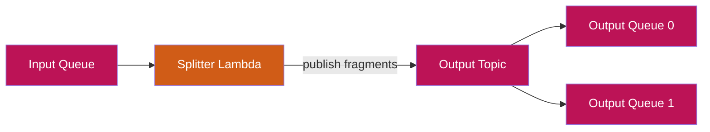

```typescript
import { Splitter } from './lib';

new Splitter(this, 'OrderSplitter', {
  splitterHandler: 'index.handler',
  splitterCode: lambda.Code.fromAsset('lambda/split'),
  outputQueueCount: 3,
});
```

**EIP Classification:** Messaging → Splitter → Polling Consumer

**AWS Services:** SQS, Lambda, SNS

---

#### Resequencer
Reorders out-of-sequence messages using DynamoDB state keyed by batchId + sequenceId.


```typescript
import { Resequencer } from './lib';

new Resequencer(this, 'OrderResequencer', {
  collectorHandler: 'index.handler',
  collectorCode: lambda.Code.fromAsset('lambda/collect'),
  dispatcherHandler: 'index.handler',
  dispatcherCode: lambda.Code.fromAsset('lambda/dispatch'),
  ttlSeconds: 120,
});
```

**EIP Classification:** Messaging → Resequencer → Polling Consumer

**AWS Services:** SQS, Lambda, DynamoDB (state table with streams + TTL)

---

#### ContentEnricher
Enriches messages by calling external services or databases before forwarding.

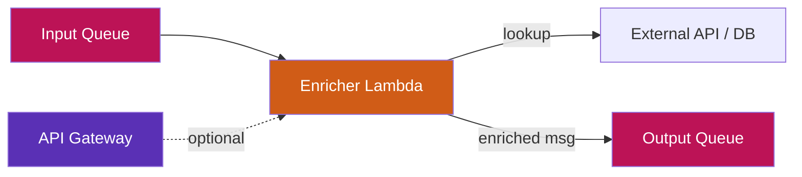

```typescript
import { ContentEnricher } from './lib';

new ContentEnricher(this, 'CustomerEnricher', {
  enricherHandler: 'index.handler',
  enricherCode: lambda.Code.fromAsset('lambda/enrich'),
  createApi: true,
});
```

**EIP Classification:** Messaging → Content Enricher → Message Channel

**AWS Services:** SQS, Lambda, API Gateway (optional)

---

### API Composition Patterns

#### ApiCompositionAppSync
Synchronous aggregation via AppSync GraphQL with unit and pipeline resolvers.

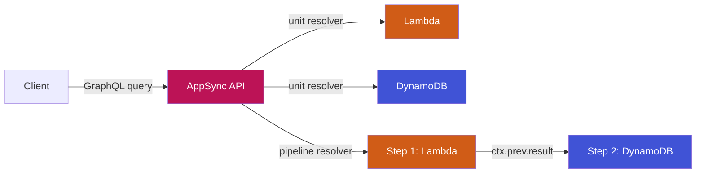

```typescript
import { ApiCompositionAppSync } from './lib';

new ApiCompositionAppSync(this, 'ProductApi', {
  schemaPath: 'schema.graphql',
  resolvers: [
    { typeName: 'Query', fieldName: 'getUser', kind: 'lambda',
      lambdaConfig: { handler: 'index.handler', code: lambda.Code.fromAsset('lambda/user') } },
    { typeName: 'Query', fieldName: 'getOrders', kind: 'dynamodb' },
  ],
  pipelineResolvers: [{
    typeName: 'Query',
    fieldName: 'getUserWithOrders',
    steps: [0, 1],  // calls resolver 0 then resolver 1 in sequence
  }],
});
```

**EIP Classification:** API Composition (Sync Aggregator) → Pipeline Resolver

**AWS Services:** AppSync, Lambda, DynamoDB

---

#### ApiCompositionApollo
Apollo Federation gateway on ECS Fargate behind an ALB.

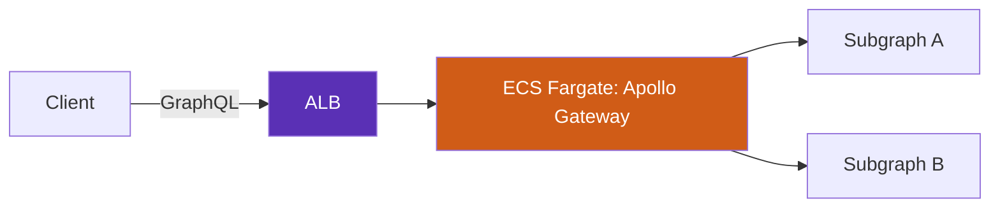

```typescript
import { ApiCompositionApollo } from './lib';

new ApiCompositionApollo(this, 'FederatedGateway', {
  vpc: myVpc,
  containerImage: ecs.ContainerImage.fromAsset('docker/apollo-gateway'),
  desiredCount: 2,
  certificate: myAcmCert,    // strongly recommended — terminates HTTPS + redirects HTTP
  publicLoadBalancer: false, // keep internal unless edge auth fronts the gateway
});
```

**AWS Services:** ECS Fargate, ALB

---

### Event & Streaming Patterns

#### EventStreaming
Kinesis-based event streaming for CQRS and audit logging.

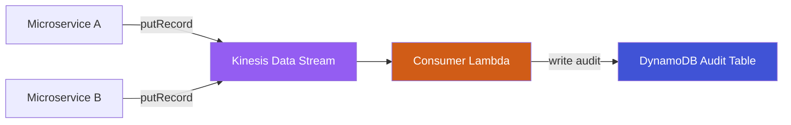

```typescript
import { EventStreaming } from './lib';

new EventStreaming(this, 'AuditStream', {
  shardCount: 2,
  consumerHandler: 'index.handler',
  consumerCode: lambda.Code.fromAsset('lambda/audit'),
  retentionPeriodHours: 168,
});
```

**EIP Classification:** Messaging → Message Channel → Event Streaming (CQRS)

**AWS Services:** Kinesis Data Streams, Lambda, DynamoDB

---

#### ClaimCheck
Stores large payloads in S3 and passes claim tokens through SQS.

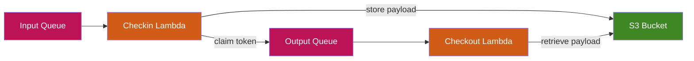

```typescript
import { ClaimCheck } from './lib';

new ClaimCheck(this, 'LargePayload', {
  checkinHandler: 'index.handler',
  checkinCode: lambda.Code.fromAsset('lambda/checkin'),
  checkoutHandler: 'index.handler',
  checkoutCode: lambda.Code.fromAsset('lambda/checkout'),
});
```

**EIP Classification:** Messaging → Claim Check

**AWS Services:** SQS, S3, Lambda

---

#### MessageReplayArchive
Archives all messages to S3 with DynamoDB metadata and provides an API for replay.

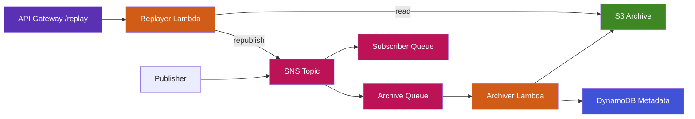

```typescript
import { MessageReplayArchive } from './lib';

new MessageReplayArchive(this, 'OrderArchive', {
  archiveHandler: 'index.handler',
  archiveCode: lambda.Code.fromAsset('lambda/archive'),
  replayHandler: 'index.handler',
  replayCode: lambda.Code.fromAsset('lambda/replay'),
  subscriberQueueCount: 2,
});
```

**Replay API Endpoints (IAM-authenticated by default — pass `apiAuthorizer` for a custom authorizer):**
- `GET /messageArchive/by-date/{date}` — retrieve archived messages by date
- `POST /messageArchive/replay/{messageId}` — republish a specific message

**AWS Services:** SNS, SQS, S3, DynamoDB, API Gateway, Lambda

---

### Saga Patterns

#### SagaChoreography
Event-driven saga with compensation chain. Each step publishes to success or failure topics. Failure propagates backward through compensation functions for full rollback.

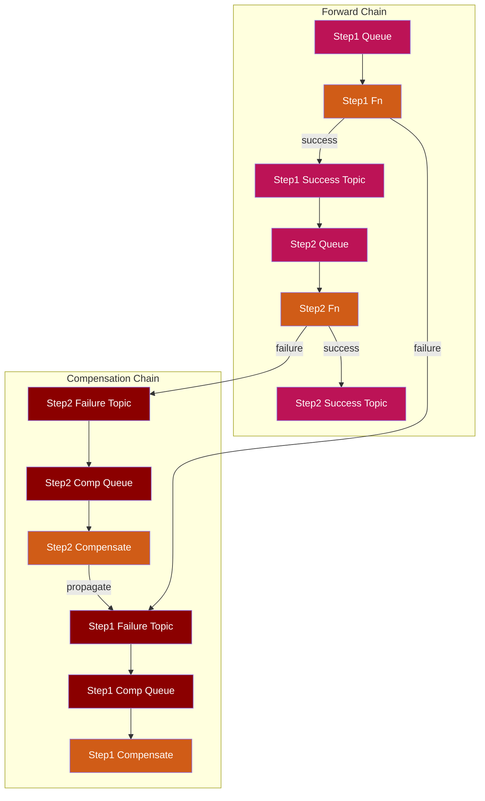

```typescript
import { SagaChoreography } from './lib';

new SagaChoreography(this, 'OrderSaga', {
  steps: [
    { name: 'ReserveStock',
      handler: 'index.handler', code: lambda.Code.fromAsset('lambda/reserve'),
      compensationHandler: 'index.handler', compensationCode: lambda.Code.fromAsset('lambda/unreserve') },
    { name: 'ChargePayment',
      handler: 'index.handler', code: lambda.Code.fromAsset('lambda/charge'),
      compensationHandler: 'index.handler', compensationCode: lambda.Code.fromAsset('lambda/refund') },
    { name: 'ShipOrder',
      handler: 'index.handler', code: lambda.Code.fromAsset('lambda/ship'),
      compensationHandler: 'index.handler', compensationCode: lambda.Code.fromAsset('lambda/cancel-ship') },
  ],
});
```

**Flow:**
```
Entry → Step1 Queue → Step1 Fn ──success──→ Step2 Queue → Step2 Fn ──success──→ Step3
                         │                                    │
                       failure                              failure
                         ↓                                    ↓
                   Step1 Failure Topic                  Step2 Failure Topic
                         ↓                                    ↓
                   Step1 Comp Queue                     Step2 Comp Queue
                         ↓                                    ↓
                   Step1 Compensate ←──propagate──── Step2 Compensate
```

**EIP Classification:** Messaging → Saga (Event Choreography) → Compensation

**AWS Services:** SNS (success + failure topics per step), SQS, Lambda

---

#### SagaOrchestration
Centrally orchestrated saga using Step Functions with try/catch compensation.

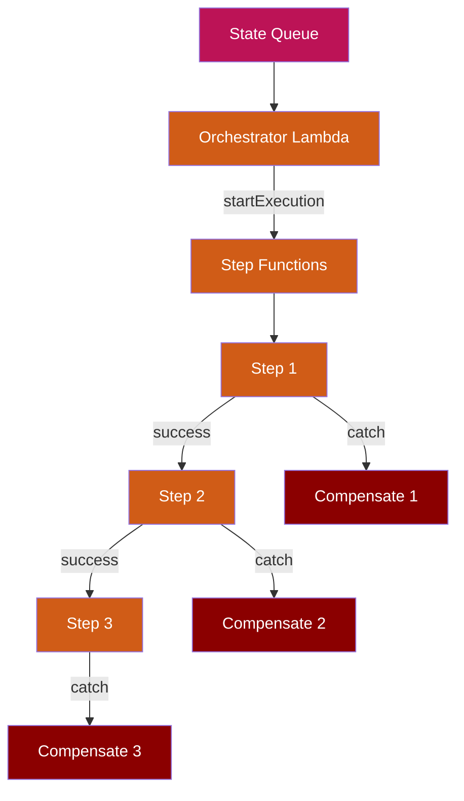

```typescript
import { SagaOrchestration } from './lib';

new SagaOrchestration(this, 'FulfilmentSaga', {
  steps: [
    { name: 'ReserveStock', handler: 'index.handler', code: lambda.Code.fromAsset('lambda/reserve'),
      compensationHandler: 'index.handler', compensationCode: lambda.Code.fromAsset('lambda/unreserve') },
    { name: 'ChargePayment', handler: 'index.handler', code: lambda.Code.fromAsset('lambda/charge'),
      compensationHandler: 'index.handler', compensationCode: lambda.Code.fromAsset('lambda/refund') },
    { name: 'ShipOrder', handler: 'index.handler', code: lambda.Code.fromAsset('lambda/ship') },
  ],
});
```

**EIP Classification:** Messaging → Saga (Event Orchestration) → Step Functions

**AWS Services:** Step Functions, SQS, Lambda

---

### Reliability & Governance Patterns

#### IdempotentReceiver
Wraps a consumer with a DynamoDB-backed dedup table so duplicate deliveries are safely ignored.

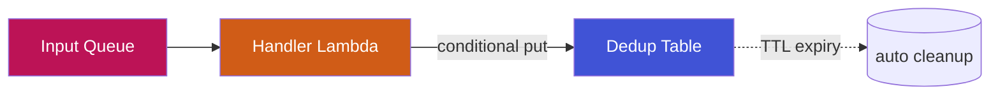

```typescript
import { IdempotentReceiver } from './lib';

new IdempotentReceiver(this, 'OrderConsumer', {
  handler: 'index.handler',
  code: lambda.Code.fromAsset('lambda/order-consumer'),
  idAttributeName: 'orderId',
  dedupTtlSeconds: 86400,
});
```

**Env injected:** `DEDUP_TABLE`, `DEDUP_ID_ATTRIBUTE`, `DEDUP_TTL_SECONDS`. Use AWS Lambda Powertools `idempotency` against the table for plug-and-play dedup.

**EIP Classification:** Messaging Endpoints → Idempotent Receiver

**AWS Services:** SQS, DynamoDB (TTL), Lambda

---

#### WireTap
Mirrors EventBridge bus traffic to an S3 audit archive via Firehose without affecting consumers.

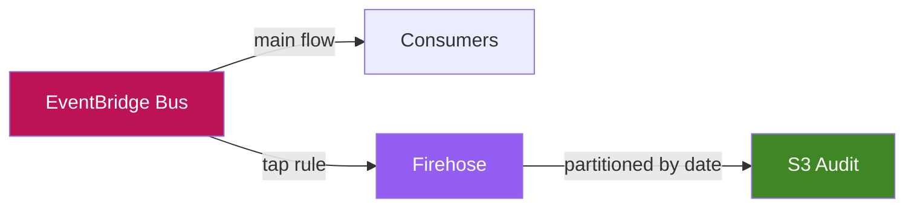

```typescript
import { WireTap } from './lib';

new WireTap(this, 'AuditTap', {
  eventBus: myBus,
  eventPattern: { source: ['orders', 'payments'] },
  archiveExpirationDays: 365,
});
```

**EIP Classification:** Systems Management → Wire Tap

**AWS Services:** EventBridge, Kinesis Firehose, S3

---

#### MessageFilter
Drops messages that do not match a predicate. Declarative EventBridge rule, no Lambda hop unless one is the target.

```typescript
import { MessageFilter } from './lib';

new MessageFilter(this, 'HighValueOrders', {
  eventBus: myBus,
  eventPattern: {
    source: ['orders'],
    detail: { totalCents: [{ numeric: ['>=', 100000] }] },
  },
  target: 'sqs',
});
```

**EIP Classification:** Message Routing → Message Filter

**AWS Services:** EventBridge, SQS / SNS / Lambda

---

#### Outbox
Transactional Outbox over DynamoDB Streams + EventBridge Pipes. Producers write outbox rows in the same transaction as business state; the pipe relays them to SNS.

```mermaid
graph LR
    APP[App Code] -->|"transactWrite (state + outbox)"| DDB[Outbox Table]
    DDB -->|streams: INSERT only| PIPE[EventBridge Pipe]
    PIPE --> TOPIC[SNS Topic]
    PIPE -.->|on failure| DLQ[Pipe DLQ]
    style DDB fill:#4053D6,color:#fff
    style PIPE fill:#945DF2,color:#fff
    style TOPIC fill:#BC1356,color:#fff
    style DLQ fill:#8B0000,color:#fff
```

```typescript
import { Outbox } from './lib';

const outbox = new Outbox(this, 'OrderOutbox');
// Producer writes business state + outbox row in one TransactWriteItems.
new CfnOutput(this, 'OutboxTable', { value: outbox.outboxTable.tableName });
new CfnOutput(this, 'OutboxTopic', { value: outbox.topic.topicArn });
```

**EIP Classification:** Modern Cloud → Transactional Outbox

**AWS Services:** DynamoDB (Streams), EventBridge Pipes, SNS, SQS (DLQ)

---

#### MessageTranslator
Format / schema conversion. Caller-supplied translator Lambda receives source-format messages and emits canonical-format messages on the output queue.

```typescript
import { MessageTranslator } from './lib';

new MessageTranslator(this, 'PartnerOrderMapper', {
  translatorHandler: 'index.handler',
  translatorCode: lambda.Code.fromAsset('lambda/translate'),
  sourceSchema: 'xml/partner-order/v1',
  targetSchema: 'json/canonical-order/v2',
  schemaRegistryName: 'integration-registry',
  schemaName: 'CanonicalOrder',
});
```

**Env injected:** `OUTPUT_QUEUE_URL`, `SOURCE_SCHEMA`, `TARGET_SCHEMA`, `SCHEMA_REGISTRY_NAME`, `SCHEMA_NAME`.

**EIP Classification:** Message Transformation → Message Translator

**AWS Services:** SQS, Lambda (+ optional Glue Schema Registry)

---

#### FileTransfer
SFTP/FTPS file ingestion via AWS Transfer Family into an S3 landing bucket, fanned out via EventBridge with an optional ingestion Lambda.

```mermaid
graph LR
    PRT[Partner SFTP Client] --> SRV[Transfer Family Server]
    SRV --> LAND[S3 Landing Bucket]
    LAND --> EB[EventBridge]
    EB --> ING[Ingestion Lambda]
    style SRV fill:#5A30B5,color:#fff
    style LAND fill:#3F8624,color:#fff
    style EB fill:#BC1356,color:#fff
    style ING fill:#D05C17,color:#fff
```

```typescript
import { FileTransfer } from './lib';

const ft = new FileTransfer(this, 'PartnerSftp', {
  protocol: 'SFTP',
  fileRetentionDays: 30,
  ingestionHandler: 'index.handler',
  ingestionCode: lambda.Code.fromAsset('lambda/ingest'),
});
// Add SFTP users separately, e.g.:
// new transfer.CfnUser(this, 'PartnerA', {
//   serverId: ft.server.attrServerId,
//   userName: 'partner-a',
//   role: ft.userRole.roleArn,
//   homeDirectory: `/${ft.landingBucket.bucketName}/partner-a`,
// });
```

**EIP Classification:** Integration Styles → File Transfer

**AWS Services:** AWS Transfer Family, S3, EventBridge, Lambda

---

#### Throttling
Two-layer rate limiter: SQS-fronted worker with reserved concurrency (downstream protection) and an optional API Gateway facade with a usage plan (partner protection).

```typescript
import { Throttling } from './lib';

new Throttling(this, 'PartnerApiThrottle', {
  workerHandler: 'index.handler',
  workerCode: lambda.Code.fromAsset('lambda/call-partner'),
  workerReservedConcurrency: 10,
  createApi: true,
  rateLimitRps: 50,
  burstLimit: 100,
  dailyQuota: 1_000_000,
});
```

**EIP Classification:** Modern Cloud → Throttling / Rate Limiter

**AWS Services:** SQS, Lambda (reserved concurrency), API Gateway (usage plans)

---

#### CircuitBreaker
DynamoDB-backed breaker state in front of a downstream call. Caller's Lambda reads/writes breaker state with the surfaced env vars; AWS Lambda Powertools `circuit-breaker` style logic plugs straight in.

```typescript
import { CircuitBreaker } from './lib';

new CircuitBreaker(this, 'PaymentGatewayBreaker', {
  handler: 'index.handler',
  code: lambda.Code.fromAsset('lambda/charge'),
  failureThreshold: 5,
  cooldownSeconds: 30,
  breakerKey: 'payment-gateway-v1',
});
```

**EIP Classification:** Modern Cloud → Circuit Breaker

**AWS Services:** SQS, DynamoDB (TTL), Lambda

---

#### RetryWithBackoff
SQS-driven retry with configurable visibility-timeout backoff. Worker throws on transient failure; SQS redrives. Worker may extend visibility for adaptive exponential backoff.

```typescript
import { RetryWithBackoff } from './lib';

new RetryWithBackoff(this, 'PartnerWebhook', {
  workerHandler: 'index.handler',
  workerCode: lambda.Code.fromAsset('lambda/webhook'),
  initialVisibilityTimeoutSeconds: 30,
  backoffMultiplier: 2,
  maxVisibilityTimeoutSeconds: 900,
  maxAttempts: 6,
});
```

**Env injected:** `QUEUE_URL`, `RETRY_INITIAL_SECONDS`, `RETRY_MULTIPLIER`, `RETRY_MAX_SECONDS`, `RETRY_MAX_ATTEMPTS`.

**EIP Classification:** Modern Cloud → Retry with Backoff

**AWS Services:** SQS, Lambda

---

#### ProcessManager
Linear, centrally orchestrated workflow without compensation. Use when "stop on failure" is acceptable — approval workflows, ingestion pipelines, BPM-lite. Reach for `SagaOrchestration` if you need rollback.

```typescript
import { ProcessManager } from './lib';

new ProcessManager(this, 'OnboardingFlow', {
  steps: [
    { name: 'Validate', handler: 'index.handler', code: lambda.Code.fromAsset('lambda/validate'), maxRetries: 2 },
    { name: 'Provision', handler: 'index.handler', code: lambda.Code.fromAsset('lambda/provision') },
    { name: 'Notify',   handler: 'index.handler', code: lambda.Code.fromAsset('lambda/notify') },
  ],
});
```

**EIP Classification:** Message Routing → Process Manager

**AWS Services:** Step Functions, SQS, Lambda

---

#### RoutingSlip
Producer-supplied itinerary array dictates the order of steps at runtime. Step Functions Map iterates the slip; a dispatcher invokes the matching step's Lambda.

```typescript
import { RoutingSlip } from './lib';

new RoutingSlip(this, 'OrderSlip', {
  steps: [
    { name: 'validate', handler: 'index.handler', code: lambda.Code.fromAsset('lambda/validate') },
    { name: 'enrich',   handler: 'index.handler', code: lambda.Code.fromAsset('lambda/enrich') },
    { name: 'publish',  handler: 'index.handler', code: lambda.Code.fromAsset('lambda/publish') },
  ],
});
// Producer sends:
//   { "itinerary": ["validate", "enrich", "publish"], "payload": { ... } }
```

**EIP Classification:** Message Routing → Routing Slip

**AWS Services:** Step Functions (Map), SQS, Lambda

---
